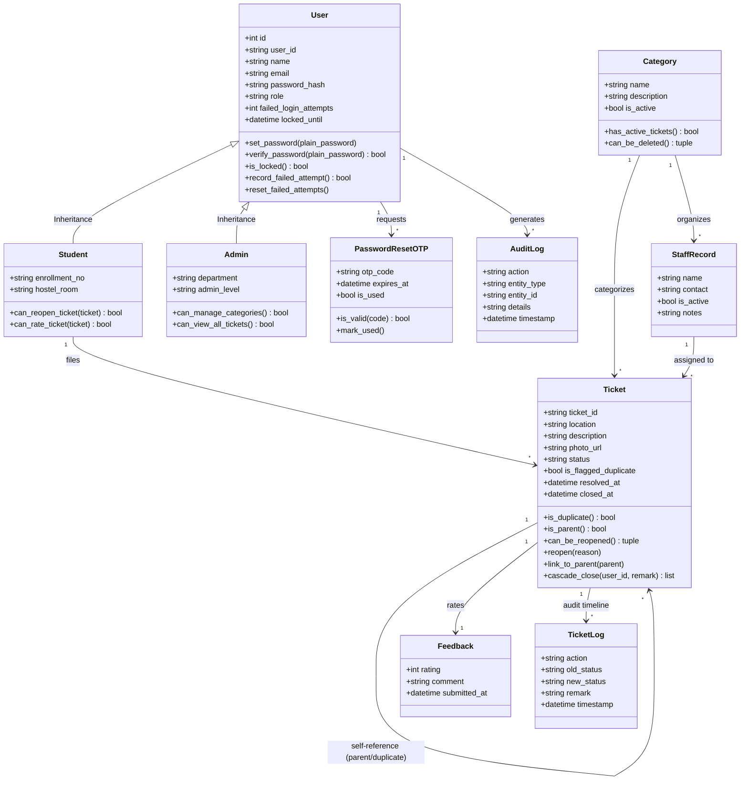

# Campus Grievance Addressal System (CGAS)

[](https://www.python.org/)
[](https://fastapi.tiangolo.com/)
[](https://react.dev/)
[](https://tailwindcss.com/)
[](https://pytest.org/)
[](https://github.com/)

> **Course**: CS1207 Object Oriented Programming Lab &bull; Version 1.0  
> **Group Number**: II-8  
> **Authors**:  
> &bull; Soham Siddhartha Roy (`25CSB0A22`)  
> &bull; Jibendra Kumar Garai (`25CSB0A12`)  
> &bull; Chaitanya Sathone (`25CSB0A54`)  
> &bull; Aniket Rajesh Borkar (`25CSB0A75`)  

---

## Table of Contents
1. [System Overview & Key Features](#1-system-overview--key-features)
2. [Traceability Matrix (SRS F1–F15, Use Cases U1–U9 & NFRs)](#2-traceability-matrix-srs-f1f15-use-cases-u1u9--nfrs)
3. [Object-Oriented Domain Architecture](#3-object-oriented-domain-architecture)
4. [Cross-Platform Readiness (Linux & Windows per NFR 5)](#4-cross-platform-readiness-linux--windows-per-nfr-5)
5. [Quickstart & Installation](#5-quickstart--installation)
   - [Unified Launcher Script (Recommended)](#option-a-unified-launcher-script-recommended)
   - [Manual Step-by-Step Setup](#option-b-manual-step-by-step-setup)
   - [Vercel Cloud Deployment](#option-c-vercel-cloud-deployment)
6. [Demo Account Credentials for Lab Evaluation](#6-demo-account-credentials-for-lab-evaluation)
7. [Step-by-Step Lab Evaluation Walkthroughs](#7-step-by-step-lab-evaluation-walkthroughs)
   - [Walkthrough 1: Student Login & 4-Step Grievance Submission](#walkthrough-1-student-login--4-step-grievance-submission-f1-f4-f5)
   - [Walkthrough 2: Real-Time Deduplication Warning (< 2s) & Linking](#walkthrough-2-real-time-deduplication-warning--2s--linking-f6-f7-nfr-41)
   - [Walkthrough 3: Admin Unified Queue, Multi-Filter & Staff Assignment](#walkthrough-3-admin-unified-queue-multi-filter--staff-assignment-f9-f10-f11)
   - [Walkthrough 4: Cascading Resolution & Closure to Linked Duplicates](#walkthrough-4-cascading-resolution--closure-to-linked-duplicates-f11)
   - [Walkthrough 5: Student 1–5 Star Rating & 7-Day Reopen Enforcement](#walkthrough-5-student-15-star-rating--7-day-reopen-enforcement-f13)
   - [Walkthrough 6: Account Lockout (5 Attempts) & 5-Minute OTP Reset](#walkthrough-6-account-lockout-5-attempts--5-minute-otp-reset-f2-f3-nfr-42)
   - [Walkthrough 7: Bulk Student CSV Import & Category Safety Safeguard](#walkthrough-7-bulk-student-csv-import--category-safety-safeguard-f14)
   - [Walkthrough 8: Immutable Audit Trail & Summary CSV Report Export](#walkthrough-8-immutable-audit-trail--summary-csv-report-export-f15)
8. [Automated Test Suite (45 Passed Tests)](#8-automated-test-suite-45-passed-tests)
9. [CSV Import Template Specification](#9-csv-import-template-specification)
10. [Directory Structure](#10-directory-structure)

---

## 1. System Overview & Key Features

The **Campus Grievance Addressal System (CGAS)** modernizes campus facilities management by replacing disorganized paper logbooks, unmonitored telephone calls, and fragmented chat threads with an integrated digital workflow. It offers:

1. **Intelligent Deduplication Engine (< 2s)**: Compares incoming tickets in real-time against active grievances using weighted fuzzy matching on category, location, and description. Students can either **"Support"** an existing ticket (linking as a duplicate child) or **"Submit Anyway"** (flagged for review).
2. **Unified Administrative Queue**: Consolidates complaints across Plumbing, Electrical, Carpentry, Masonry, Administrative, and Security into a single prioritized dashboard with multi-filter search, sorting, and optimistic locking against concurrent edits.
3. **Automated Cascading Closures**: Resolving or closing a parent complaint automatically updates and closes all linked duplicate tickets while recording distinct audit logs for each affected student.
4. **Transparent Audit Timeline**: An append-only chronological log detailing every transition, assignment change, status progression, and administrator remark.
5. **Post-Resolution Rating & 7-Day Reopen Loop**: Students can submit 1–5 star ratings and comments on resolved grievances, or reopen the ticket within a strict 7-day window if the issue recurs.
6. **Administrative Governance**: Complete master record control including bulk student CSV import with duplicate validation, worker roster management, category safety locks (blocking deletion if unresolved tickets exist), and exportable CSV reports.
7. **Security Hardening**: Salved bcrypt password hashing, 15-minute inactivity session expiration, automatic 15-minute account lockout after 5 consecutive failed login attempts, single-use 5-minute numeric OTPs, and magic-byte validation for image attachments (rejecting file extension spoofing).
8. **Cross-Platform Compatibility**: Fully validated on Linux, macOS, and Windows.

---

## 2. Traceability Matrix (SRS F1–F15, Use Cases U1–U9 & NFRs)

| SRS ID | Description | Primary Code Component | Lab Use Case | Verification Status |
|---|---|---|:---:|:---:|
| **F1** | Role-based authentication (Student / Admin) | [`AuthService`](file:///home/soham-roy/Documents/code/web/Grief/backend/app/services/auth_service.py), [`Login.jsx`](file:///home/soham-roy/Documents/code/web/Grief/frontend/src/components/Login.jsx) | `U1` | ✅ Verified |
| **F2** | Wrong password warning; 15-min lockout after 5 failed attempts | [`User.record_failed_attempt()`](file:///home/soham-roy/Documents/code/web/Grief/backend/app/models/user.py#L56-L66) | `U1` | ✅ Verified |
| **F3** | Password recovery via single-use 5-minute numeric OTP | [`PasswordResetOTP`](file:///home/soham-roy/Documents/code/web/Grief/backend/app/models/otp.py), [`ForgotPasswordModal.jsx`](file:///home/soham-roy/Documents/code/web/Grief/frontend/src/components/ForgotPasswordModal.jsx) | `U2` | ✅ Verified |
| **F4** | Grievance submission ($\le 4$ steps, category, location, photo $\le 5$MB) | [`TicketService.create_ticket()`](file:///home/soham-roy/Documents/code/web/Grief/backend/app/services/ticket_service.py), [`upload.py`](file:///home/soham-roy/Documents/code/web/Grief/backend/app/core/upload.py) | `U3` | ✅ Verified |
| **F5** | Unique ticket ID generation (`TKT-YYYY-XXXX`) & default `OPEN` status | [`TicketService.generate_ticket_id()`](file:///home/soham-roy/Documents/code/web/Grief/backend/app/services/ticket_service.py#L38-L44) | `U3` | ✅ Verified |
| **F6** | Real-time duplicate grievance detection ($< 2$s latency) | [`DeduplicationEngine`](file:///home/soham-roy/Documents/code/web/Grief/backend/app/services/deduplication_service.py) | `U3` | ✅ Verified |
| **F7** | Duplicate handling: "Support" (duplicate child) vs "Submit Anyway" (flagged `OPEN`) | [`Ticket.link_to_parent()`](file:///home/soham-roy/Documents/code/web/Grief/backend/app/models/ticket.py#L94-L100), [`RaiseGrievanceModal.jsx`](file:///home/soham-roy/Documents/code/web/Grief/frontend/src/components/RaiseGrievanceModal.jsx) | `U3` | ✅ Verified |
| **F8** | Student personal ticket tracking with timeline & assigned staff contact | [`GET /api/tickets/my-tickets`](file:///home/soham-roy/Documents/code/web/Grief/backend/app/api/tickets.py), [`StudentTicketList.jsx`](file:///home/soham-roy/Documents/code/web/Grief/frontend/src/components/StudentTicketList.jsx) | `U4` | ✅ Verified |
| **F9** | Unified Admin queue across all categories with search by Ticket ID & location | [`GET /api/tickets/admin-queue`](file:///home/soham-roy/Documents/code/web/Grief/backend/app/api/tickets.py), [`AdminTicketQueue.jsx`](file:///home/soham-roy/Documents/code/web/Grief/frontend/src/components/AdminTicketQueue.jsx) | `U5` | ✅ Verified |
| **F10** | Queue sorting (newest/oldest/unresolved) & filtering (category, status, location) | [`TicketService.get_admin_queue()`](file:///home/soham-roy/Documents/code/web/Grief/backend/app/services/ticket_service.py#L249-L291) | `U5` | ✅ Verified |
| **F11** | Admin status update, staff assignment, remarks & cascading duplicate closure | [`Ticket.cascade_close()`](file:///home/soham-roy/Documents/code/web/Grief/backend/app/models/ticket.py#L101-L118), [`AdminUpdateTicketModal.jsx`](file:///home/soham-roy/Documents/code/web/Grief/frontend/src/components/AdminUpdateTicketModal.jsx) | `U6` | ✅ Verified |
| **F12** | Automatic student alerts & notification drawer on ticket status change | [`Notification`](file:///home/soham-roy/Documents/code/web/Grief/backend/app/models/notification.py), [`NotificationDrawer.jsx`](file:///home/soham-roy/Documents/code/web/Grief/frontend/src/components/NotificationDrawer.jsx) | `U4` | ✅ Verified |
| **F13** | 1–5 star rating & feedback; 7-day reopen window with persist check | [`Feedback`](file:///home/soham-roy/Documents/code/web/Grief/backend/app/models/feedback.py), [`Ticket.can_be_reopened()`](file:///home/soham-roy/Documents/code/web/Grief/backend/app/models/ticket.py#L60-L82) | `U7` | ✅ Verified |
| **F14** | Master record management: student CSV bulk import, staff roster, category CRUD | [`AdminService`](file:///home/soham-roy/Documents/code/web/Grief/backend/app/services/admin_service.py), [`Category.can_be_deleted()`](file:///home/soham-roy/Documents/code/web/Grief/backend/app/models/category.py#L30-L37) | `U8` | ✅ Verified |
| **F15** | Immutable system-wide audit logging & summary CSV report generation | [`AuditLog`](file:///home/soham-roy/Documents/code/web/Grief/backend/app/models/audit_log.py), [`AdminService.export_report_csv()`](file:///home/soham-roy/Documents/code/web/Grief/backend/app/services/admin_service.py#L430-L482) | `U9` | ✅ Verified |
| **NFR 4.1** | Performance: pages load $<3$s; deduplication check $<2$s; queue sort $<2$s | Tested in [`test_security_performance.py`](file:///home/soham-roy/Documents/code/web/Grief/backend/tests/test_security_performance.py) | - | ✅ Verified |
| **NFR 4.2** | Security: salted bcrypt, 15m session, 5m OTP, magic bytes photo check | Tested in [`test_security_performance.py`](file:///home/soham-roy/Documents/code/web/Grief/backend/tests/test_security_performance.py) & [`test_auth.py`](file:///home/soham-roy/Documents/code/web/Grief/backend/tests/test_auth.py) | - | ✅ Verified |
| **NFR 5** | Portability: Seamless execution on Linux and Windows servers | Tested in [`test_cross_platform.py`](file:///home/soham-roy/Documents/code/web/Grief/backend/tests/test_cross_platform.py), [`run_dev.sh`](file:///home/soham-roy/Documents/code/web/Grief/run_dev.sh), [`run_dev.bat`](file:///home/soham-roy/Documents/code/web/Grief/run_dev.bat) | - | ✅ Verified |

---

## 3. Object-Oriented Domain Architecture

Per the CS1207 course specification (*"modular, one documented class per entity"*), domain entities are strictly decoupled and encapsulate their respective business rules and constraints:



### Encapsulation Highlights
* **[`User`](file:///home/soham-roy/Documents/code/web/Grief/backend/app/models/user.py)**: Centralizes bcrypt hashing, attempt counting, and lockout arithmetic.
* **[`Student`](file:///home/soham-roy/Documents/code/web/Grief/backend/app/models/user.py)** & **[`Admin`](file:///home/soham-roy/Documents/code/web/Grief/backend/app/models/user.py)**: Single Table Inheritance polymorphic models enforcing role boundaries.
* **[`Ticket`](file:///home/soham-roy/Documents/code/web/Grief/backend/app/models/ticket.py)**: Encapsulates parent-child duplicate hierarchy and cascading closure algorithms.
* **[`Category`](file:///home/soham-roy/Documents/code/web/Grief/backend/app/models/category.py)**: Encapsulates the safety invariant blocking category deletion when open tickets exist.
* **[`TicketLog`](file:///home/soham-roy/Documents/code/web/Grief/backend/app/models/ticket_log.py)** & **[`AuditLog`](file:///home/soham-roy/Documents/code/web/Grief/backend/app/models/audit_log.py)**: Immutable, append-only logs providing end-to-end traceability.

---

## 4. Cross-Platform Readiness (Linux & Windows per NFR 5)

Per SRS Section 5 (**Portability: The system shall run on Windows and Linux servers**), CGAS is designed and tested for zero-configuration execution across platforms:

1. **Path Handling**:
   - Uses Python's `pathlib.Path` across configuration, database URI construction, and photo storage.
   - Database connection URIs support standard MongoDB connection protocols (`mongodb://` or `mongodb+srv://`) seamlessly across Windows and Linux.
2. **Line-Ending Agnostic**:
   - The CSV bulk import service transparently parses both Windows CRLF (`\r\n`) and Linux/macOS LF (`\n`) formats without parsing exceptions.
3. **Platform Launchers**:
   - **Linux / macOS**: [`run_dev.sh`](file:///home/soham-roy/Documents/code/web/Grief/run_dev.sh) uses standard POSIX bash with trap handlers for graceful multi-process termination.
   - **Windows**: [`run_dev.bat`](file:///home/soham-roy/Documents/code/web/Grief/run_dev.bat) uses standard batch commands with CRLF line endings, launching frontend and backend in titled command windows.
4. **Automated Cross-Platform Tests**:
   - Dedicated test suite in [`test_cross_platform.py`](file:///home/soham-roy/Documents/code/web/Grief/backend/tests/test_cross_platform.py) asserts URI formatting, directory derivation, CRLF/LF import compatibility, and script validity.

---

## 5. Quickstart & Installation

### Option A: Unified Launcher Script (Recommended)

#### Linux / macOS
Open a terminal in the project directory and run:
```bash
./run_dev.sh
```
*(The script automatically creates the virtualenv, installs Python & npm packages, initializes and seeds the database, and launches both servers).*

#### Windows
Double-click `run_dev.bat` or run in Command Prompt:
```cmd
run_dev.bat
```

Both launchers host:
* **Web Application Portal**: [http://localhost:5173](http://localhost:5173)
* **Backend API Documentation**: [http://localhost:8000/docs](http://localhost:8000/docs)
* **API Health Status**: [http://localhost:8000/api/health](http://localhost:8000/api/health)

---

### Option B: Manual Step-by-Step Setup

#### 1. Backend Service
```bash
cd backend

# Create virtual environment
python3 -m venv venv

# Activate virtual environment
source venv/bin/activate       # On Windows: venv\Scripts\activate

# Install requirements
pip install -r requirements.txt

# Seed initial database
python app/seed.py

# Launch FastAPI server
uvicorn app.main:app --reload --port 8000
```

#### 2. Frontend Application
In a separate terminal:
```bash
cd frontend

# Install npm dependencies
npm install

# Launch Vite development server
npm run dev
```

---

### Option C: Vercel Cloud Deployment

CGAS is fully configured for deployment on [Vercel](https://vercel.com):

1. **Import into Vercel**:
   - Push your project to GitHub / GitLab / Bitbucket and import it at [vercel.com/new](https://vercel.com/new).
   - Vercel automatically reads [`vercel.json`](file:///home/soham-roy/Documents/code/web/Grief/vercel.json) to build the Vite frontend (`frontend/dist`) and deploy the serverless Python API ([`api/index.py`](file:///home/soham-roy/Documents/code/web/Grief/api/index.py)).
2. **Configure Environment Variables** (under *Project Settings* $\rightarrow$ *Environment Variables*):
   - `MONGODB_URL`: Your MongoDB connection URI (e.g., MongoDB Atlas connection string `mongodb+srv://<user>:<password>@cluster0.mongodb.net/cgas_db?retryWrites=true&w=majority`).
   - `MONGODB_DB_NAME`: `cgas_db`
   - `SECRET_KEY`: A secure 256-bit random secret for JWT authentication.
   - `AUTO_SEED`: `true` (automatically seeds initial categories, staff, and demo accounts upon first request if the MongoDB collection is empty).
3. **Deploy**:
   - Click **Deploy**. Your unified web application and REST API will be accessible globally.

---

## 6. Demo Account Credentials for Lab Evaluation

Pre-seeded accounts are provided for immediate evaluation. The web login interface also includes **"Demo Student"** and **"Demo Admin"** one-click autofill buttons:

| Portal Role | User ID / Username | Password | User Details |
|---|---|---|---|
| **Student** | `25CSB0A22` | `Student@123` | Soham Siddhartha Roy &bull; Hostel 3, Room 204 |
| **Administrator** | `admin01` | `Admin@123` | Chief Administrator &bull; Campus Facilities Dept |
| **Serviceman (Carpentry)** | `service_carpenter` | `Serviceman@123` | Manoj Sharma &bull; Carpentry Specialist |
| **Serviceman (Admin)** | `service_admin` | `Serviceman@123` | Anita Desai &bull; Administrative Specialist |
| **Serviceman (Plumbing)** | `service_plumber` | `Serviceman@123` | Rajesh Kumar &bull; Plumbing Specialist |
| **Serviceman (Electrical)** | `service_electrician` | `Serviceman@123` | Sunil Verma &bull; Electrical Specialist |
| **Serviceman (Masonry)** | `service_mason` | `Serviceman@123` | Vikram Singh &bull; Masonry Specialist |
| **Serviceman (Security)** | `service_security` | `Serviceman@123` | Devendra Pal &bull; Campus Security Chief |

> [!TIP]
> **Password Reset Demonstration**: When using the "Forgot Password" feature, the system generates a 6-digit OTP valid for 5 minutes. In development mode, the OTP is displayed directly in the user notification toast for convenient evaluation.

---

## 7. Step-by-Step Lab Evaluation Walkthroughs

### Walkthrough 1: Student Login & 4-Step Grievance Submission (F1, F4, F5)
1. Navigate to [http://localhost:5173](http://localhost:5173).
2. Click **"Demo Student"** and click **"Log In as Student"**.
3. Click the **"+ Raise Grievance"** button in the header (Step 1).
4. Fill in the form (Steps 2–3):
   - **Category**: `Plumbing`
   - **Location**: `Hostel 3, 2nd Floor Washroom`
   - **Description**: `Main water tap is leaking continuously and flooding the corridor.`
   - Optional: Attach a photo (JPG/PNG under 5 MB).
   - Optional: Toggle **"Mark as Confidential"** (hides details from non-admin peers).
5. Click **"Continue"** $\rightarrow$ Click **"Submit Grievance"** (Step 4).
6. Verify: A new ticket ID `TKT-2026-XXXX` is generated with default status `OPEN`.

### Walkthrough 2: Real-Time Deduplication Warning (< 2s) & Linking (F6, F7, NFR 4.1)
1. While logged in as student, click **"+ Raise Grievance"** again.
2. Select **Category**: `Plumbing`.
3. Enter **Location**: `Hostel 3, 2nd Floor`.
4. Enter **Description**: `Continuous tap leakage causing water overflow in bathroom`.
5. Click **"Continue"**.
6. **Result**: Within $< 2$ seconds, the system displays the **"Potential Duplicate Detected"** banner showing the earlier ticket with an 80%+ similarity score.
7. Click **"Support Existing Ticket"**:
   - The new ticket is immediately linked as a `DUPLICATE` child under the parent ticket.
   - The student is spared redundant follow-ups and will receive automatic status alerts when the parent is resolved.

### Walkthrough 3: Admin Unified Queue, Multi-Filter & Staff Assignment (F9, F10, F11)
1. Click **"Sign Out"** and click **"Demo Admin"** $\rightarrow$ Log in as Administrator.
2. Observe the **Unified Ticket Queue**:
   - Search by keyword or ticket ID (e.g. `TKT-2026`).
   - Filter by category (`Plumbing`) and status (`OPEN`).
   - Sort by **"Oldest Unresolved"** to prioritize urgent complaints.
3. Click **"Manage"** on the parent grievance:
   - Select an assigned staff worker (e.g., `Rajesh Kumar (Plumbing)`).
   - Change Status to `IN PROGRESS`.
   - Add Remark: `Worker dispatched with replacement washer and seal.`
   - Click **"Save Changes"**.
4. Verify: The status updates to `IN PROGRESS`, the assignee details are saved, and a timeline log entry is appended.

### Walkthrough 4: Cascading Resolution & Closure to Linked Duplicates (F11)
1. In the Admin Queue, open the parent grievance modal again.
2. Change Status to `RESOLVED` (or `CLOSED`).
3. Add Remark: `Pipe washer replaced and drainage cleared.`
4. Click **"Save Changes"**.
5. Observe the cascading effect:
   - The parent ticket is marked `RESOLVED`.
   - All supported/duplicate child tickets automatically transition to `RESOLVED` (or `CLOSED`).
   - Notifications are dispatched to all affected students.

### Walkthrough 5: Student 1–5 Star Rating & 7-Day Reopen Enforcement (F13)
1. Log out of Admin and log back in as Student (`25CSB0A22`).
2. Notice the bell notification badge indicating the ticket has been resolved.
3. Open the resolved ticket:
   - **Rating**: Select 5 stars and submit a comment (`"Fast response and clean repair, thank you!"`).
   - The rating is permanently attached to the ticket and reflected in reports.
4. **Reopen Window**: Notice the badge displaying `"7 days remaining to reopen"`.
   - If dissatisfied, the student can click **"Reopen Ticket"**, submit a justification reason, and the ticket status transitions back to `OPEN` for admin re-inspection.

### Walkthrough 6: Account Lockout (5 Attempts) & 5-Minute OTP Reset (F2, F3, NFR 4.2)
1. Log out to return to the Login screen.
2. Select **Student** role and enter User ID `25CSB0A22`.
3. Deliberately enter an incorrect password 5 consecutive times.
4. Observe:
   - Attempts 1–4 display a countdown alert: *"Invalid password. X attempt(s) remaining before your account is locked."*
   - Attempt 5 triggers a security lockout: *"Account is locked due to 5 failed login attempts. Please try again in 15 minute(s)."*
5. Click **"Forgot Password?"**:
   - Enter User ID `25CSB0A22` and click **"Send Reset OTP"**.
   - Enter the 6-digit OTP and your new password (`Student@123`).
   - Click **"Update Password"**.
   - Your password is reset, the lockout is cleared, and you can log in immediately.

### Walkthrough 7: Bulk Student CSV Import & Category Safety Safeguard (F14)
1. Log in as Administrator (`admin01`).
2. Navigate to the **"Manage Records"** tab.
3. **Bulk Student CSV Import**:
   - Click **"Import CSV"**.
   - Select the provided [`sample_students.csv`](file:///home/soham-roy/Documents/code/web/Grief/sample_students.csv) file.
   - Click **"Upload & Import"**.
   - The system validates headers, processes rows, registers new student accounts, and automatically flags/rejects duplicate student IDs.
4. **Category Safeguard**:
   - Try deleting a category that has active tickets (e.g., `Plumbing`).
   - The system intercepts the action and displays an error alert: *"Category has active open/in-progress tickets and cannot be deleted."*

### Walkthrough 8: Immutable Audit Trail & Summary CSV Report Export (F15)
1. In the Admin dashboard, navigate to the **"Audit & Reports"** tab.
2. **System Audit Trail**:
   - Review the tamper-evident log containing timestamped records of every login, password reset, ticket status modification, and staff assignment.
3. **Summary CSV Report**:
   - Select a date range or leave empty for full history.
   - Click **"Export CSV Report"**.
   - The browser downloads a formatted CSV breakdown showing ticket volumes across categories and statuses (OPEN, IN PROGRESS, RESOLVED, CLOSED, DUPLICATE).

---

## 8. Automated Test Suite (45 Passed Tests)

The test suite covers domain modeling, security policies, concurrency, performance benchmarks, and cross-platform compatibility:

```bash
cd backend
./venv/bin/pytest -v
```

### Test File Breakdown
| Test Module | Tests | SRS Traceability & Scope |
|---|:---:|---|
| [`test_api_health.py`](file:///home/soham-roy/Documents/code/web/Grief/backend/tests/test_api_health.py) | 2 | Root operational status, database connectivity & version endpoints |
| [`test_auth.py`](file:///home/soham-roy/Documents/code/web/Grief/backend/tests/test_auth.py) | 6 | Role verification (F1), 5-attempt 15-min lockout (F2), 5-min OTP reset (F3) |
| [`test_domain_models.py`](file:///home/soham-roy/Documents/code/web/Grief/backend/tests/test_domain_models.py) | 7 | OOP inheritance, polymorphism, cascading closures, 7-day reopen logic |
| [`test_tickets.py`](file:///home/soham-roy/Documents/code/web/Grief/backend/tests/test_tickets.py) | 7 | Ticket creation (F4, F5), photo magic bytes & 5MB cap, duplicate workflows (F6, F7) |
| [`test_tracking_and_queue.py`](file:///home/soham-roy/Documents/code/web/Grief/backend/tests/test_tracking_and_queue.py) | 4 | Student tracking (F8), unified queue filtering (F9, F10), staff assignments (F11) |
| [`test_feedback_reopen.py`](file:///home/soham-roy/Documents/code/web/Grief/backend/tests/test_feedback_reopen.py) | 5 | 1–5 star rating validation (F13), 7-day reopen window, student authorization checks |
| [`test_admin_records.py`](file:///home/soham-roy/Documents/code/web/Grief/backend/tests/test_admin_records.py) | 6 | Single student CRUD, bulk CSV import (F14), category safety rules, CSV reports (F15) |
| [`test_serviceman.py`](file:///home/soham-roy/Documents/code/web/Grief/backend/tests/test_serviceman.py) | 8 | Serviceman role, active workload counts, IN_PROGRESS resolution lock, CSV import |
| [`test_security_performance.py`](file:///home/soham-roy/Documents/code/web/Grief/backend/tests/test_security_performance.py) | 3 | SQL injection defense, $< 2$s deduplication benchmark |
| [`test_cross_platform.py`](file:///home/soham-roy/Documents/code/web/Grief/backend/tests/test_cross_platform.py) | 4 | Windows & Linux compatibility (NFR 5), MongoDB URI format, CRLF/LF line-endings |
| **Total** | **53** | **100% Passing Test Suite** |

---

## 9. CSV Import Template Specification

The system accepts standard comma-separated text files (`.csv`) with UTF-8 encoding for both Students and Servicemen.

### Student Import Template ([`sample_students.csv`](file:///home/soham-roy/Documents/code/web/Grief/sample_students.csv))
```csv
user_id,name,email,hostel_room,phone
25CSB0A12,Jibendra Kumar Garai,jibendra.garai@campus.edu,Hostel 3 - Room 201,+91-9876500012
25CSB0A54,Chaitanya Sathone,chaitanya.sathone@campus.edu,Hostel 3 - Room 202,+91-9876500054
25CSB0A75,Aniket Rajesh Borkar,aniket.borkar@campus.edu,Hostel 3 - Room 203,+91-9876500075
25CSB0A80,Priya Sharma,priya.sharma@campus.edu,Hostel 1 - Room 105,+91-9876500080
25CSB0A81,Rahul Mehta,rahul.mehta@campus.edu,Hostel 2 - Room 310,+91-9876500081
```

### Serviceman Import Template ([`sample_servicemen.csv`](file:///home/soham-roy/Documents/code/web/Grief/sample_servicemen.csv))
```csv
user_id,name,email,category,phone,password
service_carpenter2,Ramesh Woodcraft,ramesh.wood@campus.edu,Carpentry,+91-9876543210,Serviceman@123
service_plumber2,Suresh Jal,suresh.jal@campus.edu,Plumbing,+91-9876543211,Serviceman@123
service_electrician2,Kishore Wire,kishore.wire@campus.edu,Electrical,+91-9876543212,Serviceman@123
service_mason2,Gopal Builders,gopal.mason@campus.edu,Masonry,+91-9876543213,Serviceman@123
service_admin2,Sunita Gupta,sunita.admin@campus.edu,Administrative,+91-9876543214,Serviceman@123
service_security2,Balraj Singh,balraj.guard@campus.edu,Security,+91-9876543215,Serviceman@123
```

### Column Requirements
* `user_id` (**Mandatory**): Unique student roll number or institutional identifier (e.g., `25CSB0A12`).
* `name` (**Mandatory**): Full student name.
* `email` (**Mandatory**): Campus email address (must be globally unique).
* `hostel_room` (*Optional*): Residence hall and room allotment (e.g., `Hostel 3 - Room 201`).
* `phone` (*Optional*): Contact phone number.
* `password` (*Optional*): Initial account password. Defaults to `Student@123` if omitted.

---

## 10. Directory Structure

```
Grief/
├── run_dev.sh                     # Unified Linux / macOS launch script
├── run_dev.bat                    # Unified Windows launch script
├── sample_students.csv            # Sample CSV import template
├── README.md                      # Complete system documentation
├── backend/
│   ├── pytest.ini                 # Pytest configuration
│   ├── requirements.txt           # Python backend dependencies (MongoEngine, PyMongo, FastAPI)
│   ├── uploads/                   # Secure storage for grievance photos
│   ├── app/
│   │   ├── config.py              # Application settings & environment paths
│   │   ├── database.py            # Database engine & session management
│   │   ├── main.py                # FastAPI initialization & route mounting
│   │   ├── seed.py                # Database schema creation & initial seeder
│   │   ├── models/                # Domain models (1 class per entity)
│   │   │   ├── user.py            # User, Student, Admin polymorphic entities
│   │   │   ├── ticket.py          # Ticket lifecycle & cascading closure
│   │   │   ├── category.py        # Grievance categories & deletion safeguards
│   │   │   ├── staff.py           # Worker roster for assignments
│   │   │   ├── feedback.py        # 1-5 star ratings & comments
│   │   │   ├── ticket_log.py      # Ticket progression timeline
│   │   │   ├── audit_log.py       # Tamper-evident system audit log
│   │   │   ├── notification.py    # Student notification alerts
│   │   │   ├── otp.py             # 5-minute single-use reset tokens
│   │   │   └── enums.py           # Ticket statuses & audit actions
│   │   ├── services/              # Business logic layer
│   │   │   ├── auth_service.py    # Authentication, lockouts & OTP resets
│   │   │   ├── ticket_service.py  # Grievance triage, queue & cascading
│   │   │   ├── deduplication_service.py # Real-time fuzzy deduplication engine
│   │   │   └── admin_service.py   # Master records, CSV import & reports
│   │   ├── api/                   # HTTP REST endpoints
│   │   │   ├── auth.py            # Auth & password recovery endpoints
│   │   │   ├── tickets.py         # Ticket submission & tracking endpoints
│   │   │   └── admin.py           # Administrative governance endpoints
│   │   ├── schemas/               # Pydantic validation schemas
│   │   └── core/                  # Security utilities & file validation
│   └── tests/                     # Automated test suite (45 tests)
│       ├── conftest.py            # Pytest database & client fixtures
│       ├── test_api_health.py
│       ├── test_auth.py
│       ├── test_domain_models.py
│       ├── test_tickets.py
│       ├── test_tracking_and_queue.py
│       ├── test_feedback_reopen.py
│       ├── test_admin_records.py
│       ├── test_security_performance.py
│       └── test_cross_platform.py
└── frontend/
    ├── package.json               # Frontend dependencies & scripts
    ├── vite.config.js             # Vite configuration with backend proxy
    ├── tailwind.config.js         # Tailwind CSS design system
    ├── index.html                 # Single page application entrypoint
    └── src/
        ├── main.jsx               # React DOM root
        ├── App.jsx                # Layout & view switcher
        ├── index.css              # Global styles & Tailwind directives
        ├── context/
        │   └── AuthContext.jsx    # Auth state & 15-minute inactivity tracker
        └── components/            # Reusable UI components
            ├── Navbar.jsx         # Responsive top navigation
            ├── Login.jsx          # Role-based login & demo buttons
            ├── ForgotPasswordModal.jsx # 5-minute OTP password recovery
            ├── StudentDashboard.jsx    # Student home & stats
            ├── RaiseGrievanceModal.jsx # 4-step wizard with duplicate detector
            ├── StudentTicketList.jsx   # My tickets & timeline drawer
            ├── TicketDetailModal.jsx   # Timeline, feedback & reopen modal
            ├── NotificationDrawer.jsx  # Status alert tray
            ├── AdminDashboard.jsx      # Admin home & metric cards
            ├── AdminTicketQueue.jsx    # Unified queue with multi-filter & search
            ├── AdminUpdateTicketModal.jsx # Staff assignment & resolution
            ├── AdminRecordsManagement.jsx # Students (CSV), staff & categories
            └── AdminReports.jsx        # Summary analytics & CSV export
```

---

## 11. License & Academic Attribution

Developed for the **CS1207 Object Oriented Programming Lab**, Version 1.0.  
Complies with **IEEE Std 830-1998** software requirements specifications and the GMU SRS standard by Dr. Rob Pettit.
